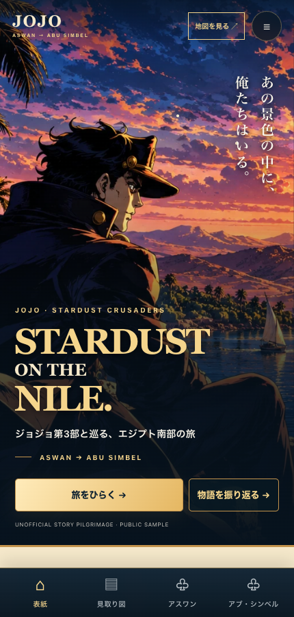
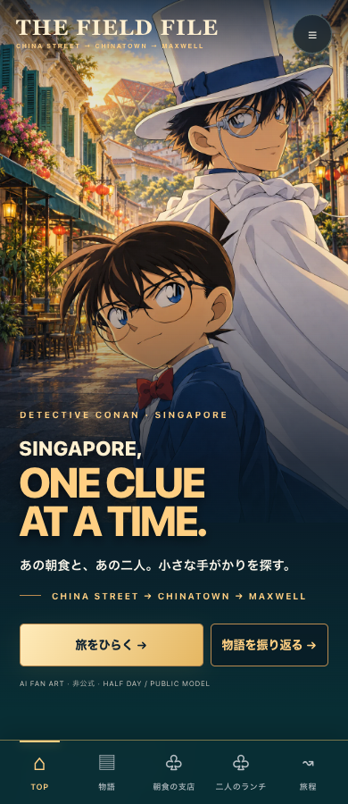
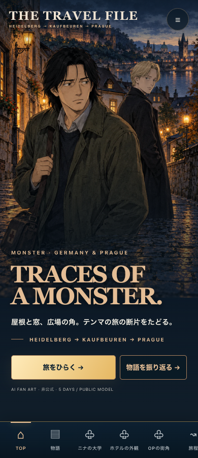
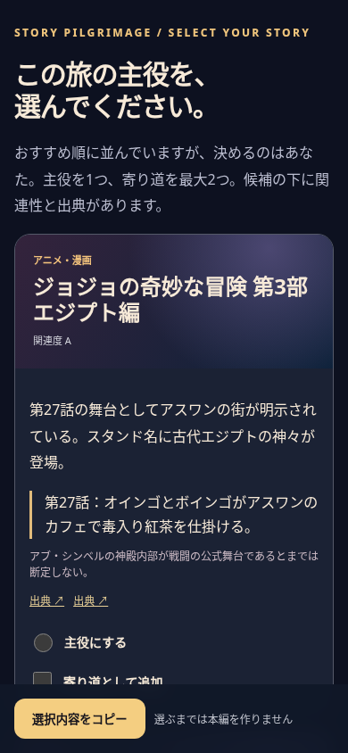

# 勝手に聖地巡礼 — seichi-junrei

**旅行予定を見せるだけ。旅先にゆかりのあるアニメ・漫画・映画をAIが探し、あなたが選んだ物語で、旅仲間向けのスマホガイドを作るSkill。**

[](https://github.com/usedhonda/seichi-junrei/actions/workflows/test.yml)
[](LICENSE)
[](SKILL.md)

**[スマホでサンプルを体験する →](https://usedhonda.github.io/seichi-junrei/)**

実際のエジプト旅行で使った「STARDUST ON THE NILE」を公開サンプルにしました。承太郎・イギー・オインゴとボインゴたちのファンアートと一緒に、物語と現地をめぐるしおりです。場面カードを開く、挿絵を拡大する、ミッションにチェックする操作を試せます。

[](https://usedhonda.github.io/seichi-junrei/)

個人の旅行日・便名・予約時刻を除いたモデルルートです。非公式ファンアートを含みます。ページの保存ボタンで画像入りHTMLを持ち歩けます。

> **「今度の旅、勝手に聖地巡礼にして。」**
>
> *Turn an ordinary itinerary into a story-driven pilgrimage for your travel companions.*

## 3つの公開サンプル

| 作品 × 行き先 | この旅で探すもの | モデル構成 |
| --- | --- | --- |
| [ジョジョ × エジプト](https://usedhonda.github.io/seichi-junrei/) | 物語と遺跡をつなぐ冒険の記憶 | 2目的地 |
| [コナン × シンガポール](https://usedhonda.github.io/seichi-junrei/conan/) | 朝食の支店、庇と屋根、二人のランチ。定番観光から一歩だけ街角へ | 半日・2目的地 |
| [MONSTER × ドイツ・チェコ](https://usedhonda.github.io/seichi-junrei/monster/) | 大学の窓、小さなホテルの屋根、OPの広場。テンマの旅の断片を探す | 移動日込み5日・3目的地 |

[](https://usedhonda.github.io/seichi-junrei/conan/)
[](https://usedhonda.github.io/seichi-junrei/monster/)

挿絵はAIで新しく制作した**非公式ファンアート**です。現地写真や公式の場面画像ではありません。作品の場面、訪問者の照合記録、現在の施設案内、創作の挿絵を分けています。制作側の認定がない個別地点や、現在との一致が未確認の場所は、その範囲を本文に記載しています。コナン版は本編全編との直接照合が未完了、MONSTER版は原作比較画像を目視した地点とアニメOPの訪問者報告を区別しています。

個人の予約を含まないモデルルートです。MONSTER版は都市間の移動専用日を置いていますが、実際の列車・接続や予約可能性は訪問日ごとに別途確認が必要です。完成HTMLの操作を検証したことと、全地点を実地検証したことは分けて案内しています。

## インストール：Codex（CDX）

**v0.4.0：場面単位の聖地調査手順と、公開サンプルと同じ制作エンジンを同梱しています。Codex専用Skillです。** この旅のしおりでは、単なるSVG装飾ではなく、物語のシーンを思い出すためのオリジナル挿絵が重要です。そこでClaude Code対応は終了し、**Codexで実際に利用可能なネイティブ画像生成機能を優先**します。別途のGemini APIキー、外部画像生成API、ローカル画像生成モデルは不要です。

### Codexプラグインとして導入

Codex CLIがプラグイン管理をサポートしている場合、OSのターミナルで：

```sh
codex plugin marketplace add usedhonda/seichi-junrei
codex plugin add seichi-junrei@seichi-junrei
```

Codexのチャット・アプリで、実際に表示されるスキルを選ぶか：

```text
$seichi-junrei:seichi-junrei 次の旅行の聖地巡礼候補を3〜5作品、根拠付きで提示して。主役は私が選ぶ。選んだ後はImageGenでオリジナル挿絵を作り、スマホ用ガイドにまとめて。
```

Codex CLIにトップレベルの `/seichi-junrei` コマンドを追加するものではありません。スキルメニュー（`/skills`）など、現在のホストに認識されている呼び出し方を優先してください。

### 直接Skillとして導入する方法

```sh
git clone https://github.com/usedhonda/seichi-junrei.git ~/.agents/skills/seichi-junrei
```

ルートの `SKILL.md` がプラグイン内の共通Skill本体を参照します。この場合は `$seichi-junrei` として見える場合があります。プラグイン版と直接導入版を両方入れる必要はありません。

### 画像制作の前提

**Codexという名前だけでImageGenが必ず使えるわけではありません。** 実行セッションで画像生成ツールが使える場合に限り、表紙・作品の場面・現地モチーフをそれぞれ独立した画像として生成します。ImageGenが利用できない場合は、外部APIやローカルモデルを勝手に追加せず、画像制作が未完了であることを伝えます。許可を得ずにSVGだけの簡易版を「完成」と呼ばない設計です。

画像は旅ごとの作業ディレクトリに保存し、プラグイン内の `render_guide.py --assets-root` でHTMLに直接埋め込みます。これにより読み込み失敗を防ぎます。画像制作やGoogleカレンダーへのアクセスは、ホストの権限・接続状況に依存します。

## 何ができる？

旅行のフライト・ホテル・滞在先から、**その土地と本当に関係のある作品を3〜5本提案**。好きな作品を選んだら、作品の名場面と現地の見どころをつないだ、読み物として楽しい旅のしおりを制作します。

| ステップ | AIが行うこと | あなたが行うこと |
| --- | --- | --- |
| ① 旅行を把握 | 接続済みGoogleカレンダーなどから移動・宿泊・自由時間を読み取る | 旅行を指定する |
| ② 作品を発見 | アニメ・漫画・映画など3〜5作品を関連の根拠付きで提示 | **主役1作品を選ぶ**（寄り道作品は最大2本） |
| ③ 聖地を検証 | アニメ話数・漫画巻数・映画のシーン、実際の舞台・ロケ地を照合 | 必要なときだけ方向性を伝える |
| ④ 旅を編集 | 実際の訪問順に、物語・歴史・観光情報を編み直す | 読んで楽しむ |
| ⑤ ビジュアル制作 | 利用可能なCodexの画像生成で独自挿絵を制作し、許諾済みの実景写真と組み合わせる | デザイン見本を指定してもよい |
| ⑥ 完成 | 画像を埋め込んだ**オフラインでも読める単一HTML**を検証して渡す | 旅仲間と共有する |

**作品の選択は必須の停止点です。** AIが候補の1位を勝手に採用したり、選ばれる前に本編を作ったりしません。「おまかせ」と明示された場合だけ選定を委任できます。

### 有名な作品から、見過ごしていた場所を見つける

発見を楽しむ旅では、作品の知名度と観光地の知名度を分けます。作中の朝食を取った支店、背景に映る屋根、何気ない通りの角などを調べ、場面の根拠・場所を特定する手がかり・現在の訪問条件を別々に記録します。検索記事の推測を確定情報に変えず、画像は説明文だけでなく実物を確認する手順です。

[`場面単位の調査手順`](plugins/seichi-junrei/references/scene-research.md)と[`コナン・シンガポールの調査例`](plugins/seichi-junrei/examples/conan_singapore_research.md)を同梱しました。調査例には、本編未照合の支店候補、画像説明の誤り、採用を保留した通りを含みます。確定済みの巡礼コースや、別セッションでの独立した能力評価ではありません。

### サンプルの品質は、標準生成処理で再利用できます

公開中のジョジョ版も、インストールしたskillと同じ `render_guide.py` から生成しています。表紙、場面カード、目的地の章、解説シート、画像拡大、章の保存、日程切替、全体と場所別のチェック集計、画像込みのHTML保存を共通化しました。テンプレート・画像・動作コードはプラグイン内に同梱し、リポジトリ外に単体でコピーしても動きます。

以前の制作検証例も保存しています：[アリス／オックスフォード](https://usedhonda.github.io/seichi-junrei/alice/)、[けいおん！／ロンドン](https://usedhonda.github.io/seichi-junrei/k-on/)。公開見本の主役は、上の3本に絞っています。

**同梱機能と、制作時に必要な仕事は分けています。** 操作や保存は共通エンジンが担当します。新しい旅行の作品調査、移動可能な行程、読み物の編集、キャラと場面に合う画像の生成・選定、顔の切り取りや文字の見やすさの調整は、skillの制作手順と実画面での確認が必要です。アリス版は既存の原著挿絵、コナン・MONSTER版は新しい画像生成を使っています。これらの制作実績は、あらゆる作品の画像生成品質や別セッションでの自律制作成功を保証するものではありません。

制作手順：[`mobile-production.md`](plugins/seichi-junrei/references/mobile-production.md)。選定した3作品を360 / 390 / 430 / 520pxで検証し、実際の再読み込みによる保存、保存不可時の動作、別の旅との進捗分離も確認するテストをCIに含めています。実機iPhone／Safariは未検証です。

### 完成イメージ

| 候補を選ぶ | 旅先で読む |
| --- | --- |
|  | [](https://usedhonda.github.io/seichi-junrei/) |

**[公開サンプルを開く](https://usedhonda.github.io/seichi-junrei/)** · **[編集可能なサンプルデータ](plugins/seichi-junrei/examples/egypt_guide.json)**。ジョジョ第3部とアスワン・アブ・シンベルを題材に、キャラ絵7点と情景画2点を収録。チェックリストは各地3件・旅全体6件で、同じ項目を別画面で操作しても同期します。[画像入りHTML](plugins/seichi-junrei/examples/sample-guide.html)も、同じ標準生成処理から出力しています。

### 会話の例

**ユーザー：**「今週末の旅行を聖地巡礼ツアーにして」

**AI：**「旅程はアスワン → アブ・シンベル。候補は『ジョジョの奇妙な冒険 第3部』『ナイル殺人事件（1978）』『ハムナプトラ（1999）』です。作品の舞台なのか、ロケ地なのか、単にテーマが近いだけなのかも分けて説明します。どれを主役にしますか？」

**ユーザー：**「ジョジョを主役に。あとは任せる」

**AI：** 第25〜29話と現地の場所を確認し、聖地と単なる連想スポットを区別。アニメの場面の振り返り・歴史・見どころを交え、スマホで読めるHTMLを制作。

## ローカルでデモを動かす（カレンダー接続不要）

Python 3.11以上が必要です。画像をHTML内蔵用に処理するため、**Pillow**を使います。

```bash
git clone https://github.com/usedhonda/seichi-junrei.git
cd seichi-junrei/plugins/seichi-junrei
python3 -m venv .venv
source .venv/bin/activate
python -m pip install -r requirements.txt

# 候補を評価して並べる（主役は自動決定しない）
python3 scripts/rank_candidates.py examples/egypt_candidates.json

# 候補選択用のHTMLを作る
python3 scripts/make_ballot.py examples/egypt_candidates.json --out /tmp/choose.html

# 選択済みのテストデータからスマホガイドを作る
python3 scripts/render_guide.py examples/egypt_guide.json --out /tmp/guide.html

# 出力検査とテスト
python3 scripts/lint_guide.py /tmp/guide.html --guide examples/egypt_guide.json
python3 -m unittest discover -s tests -v
```

`/tmp/choose.html` と `/tmp/guide.html` をブラウザで開いてください。**サンプルJSONの `selection.user_confirmed=true` は動作確認用に設定された架空の選択記録です。実旅行で流用せず、必ずその都度ユーザーの選択を取ります。**

カレンダーのJSONを書き出した場合の補助コマンド：

```bash
python3 scripts/extract_calendar.py examples/calendar_sanitization_test.json --out /tmp/trip.private.json
```

`/tmp/trip.private.json` は*内部作業用*です。共有用HTMLにそのまま入れないでください。

## 聖地の事実を守る

「作品の舞台」「実際のロケ地」「公式に確認できるモデル」「雰囲気が似ているだけ」は別物です。これらを混同せず、話数・巻数・シーン・地図・開館情報も根拠付きで確認します。裏付けがなければ聖地とは断定しません。

**画像についても、「AI生成＝自由に使えるファンアート」とは限りません。** キャラクターの特徴や既存カットの再現を避け、適切な権利確認ができる素材を使います。詳しくは[アセットの扱い](ASSETS.md)と[編集・アート方針](plugins/seichi-junrei/references/editorial-and-art.md)を参照してください。

## プライバシーと共有

標準成果物は **単一HTMLファイル**。公開URLやアカウントは不要です。旅仲間とのAirDrop・ファイル共有を想定し、画像は原則内蔵します。公開サイトを作るのはユーザーが明示的に希望した場合だけです。

予約番号・チケット番号・座席・電話番号・メールアドレス・同行者名・カレンダーの本文や非公開リンクは共有版に含めません。抽出スクリプトも元の予定タイトルをそのまま出力しません。ただし自動検査は万能ではないため、**他人に渡す前の目視確認は必須**です。

## リポジトリの中身

`plugins/seichi-junrei/` がインストール単体で動作する**共通プラグイン本体**です。ルートの `SKILL.md` は直接インストール用ラッパーに過ぎません。


| ディレクトリ | 役割 |
| --- | --- |
| [Skill本体](plugins/seichi-junrei/skills/seichi-junrei/SKILL.md) | エージェントの手順と選択・調査・品質ゲート |
| [Skill表示設定](plugins/seichi-junrei/skills/seichi-junrei/agents/openai.yaml) | Skillメタデータ |
| [references/](plugins/seichi-junrei/references/) | 旅程・根拠・制作・データ契約 |
| [scripts/](plugins/seichi-junrei/scripts/) | 旅程抽出／候補順位／選択UI／ガイド生成／検査 |
| [assets/](plugins/seichi-junrei/assets/) | 説明用の独自ビジュアル素材 |
| [examples/](plugins/seichi-junrei/examples/) | 説明用データと生成例 |
| [tests/](plugins/seichi-junrei/tests/) | 画面検証補助とPython単体テスト |

Codexの実行時機能については[Codex実行ガイド](plugins/seichi-junrei/references/codex.md)を参照。追加の外部画像APIを前提とせず、ImageGenが使える場合は画像素材を旅行ごとに生成します。

## 協力・ライセンス

不具合報告や改善提案はIssueへ。コードの変更は[CONTRIBUTING.md](CONTRIBUTING.md)を参照してください。脆弱性の連絡方法は[SECURITY.md](SECURITY.md)に記載しています。

**コードとオリジナルのドキュメントはMITライセンス**です（[LICENSE](LICENSE)）。画像・デモ内の図版はこのMIT許諾の対象外です。取り扱いは[ASSETS.md](ASSETS.md)を確認してください。作品名や商標は各権利者に帰属します。本プロジェクトは各作品の公式・公認サービスではありません。

---

<small>seichi-junrei · 勝手に聖地巡礼 · 旅先を「知っている物語」の中にする。</small>
